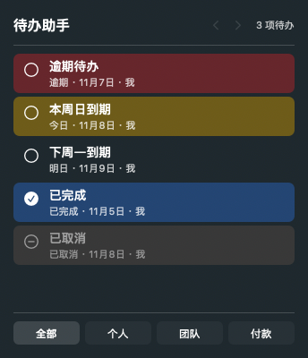

# 待办助手 · macOS

一个常驻桌面的中文待办小组件，配有独立管理窗口和菜单栏入口。**无需信息整合、聊天账号、API Key 或联网服务，就能手动添加待办。**

> 当前公开版本为预览版。下载包使用 Apple Development 开发签名，尚未经过 Developer ID 签名与 Apple 公证。已经在开发机验证；尚未在另一台干净 Mac 验收，不能保证所有 Mac 都能直接打开。请先看[安装说明](docs/INSTALL.md)。

[下载预览版](https://github.com/quennelwm/todo-assistant/releases) · [安装说明](docs/INSTALL.md) · [未来接入信息整合](docs/INTEGRATION.md)



## 开始使用

1. 下载 Releases 最新预览版中的 `macOS-universal.zip` 安装包，解压，将「待办助手.app」放入「应用程序」。
2. 首次打开会显示空白待办窗口。点击右上角 **＋**，输入事项即可添加；负责人、对接人、日期和备注可选。
3. 右键桌面空白处 → 编辑小组件 → 搜索「待办助手」→ 添加。
4. 关闭窗口后，应用继续留在菜单栏；点击菜单栏清单图标 → 打开待办助手。无需另装圆环菜单程序。

## 使用方式

- 底部「全部 / 个人 / 团队 / 付款」切换列表。点当前标签回到顶部；切换其他标签时从第一页开始。
- 桌面列表右上角的左右箭头翻页。长标题最多显示两行，点击文字查看完整内容。
- 左侧圆圈标记完成；取消事项在详情或主窗口的更多菜单中操作。完成后可撤销，取消后可恢复。
- 顶部「待办助手」打开主窗口；小组件里的事项文字打开对应详情。
- 来源在列表中只显示微信、企微、短信、截图、照片、文档等简短类别；完整文件名与编号保留在详情。
- 名称、负责人、对接人及截止日期可以修改。人工修改在后续整合刷新时保留。
- 逾期红、本周到期黄、完成蓝、取消灰。本周按北京时间周一至周日计算。
- 在主窗口右上角打开「设置 → 外观」，可分别调底板和卡片底色透明度。壁纸透出效果由 macOS 的「图标与小组件样式」决定。
- 所有内容保存在当前 Mac；没有账号登录、云同步或团队共享服务器。「团队」是事项分类，不会自动发送给同事。
- 「付款」预留给整合发布的款项清单，未接入时为空。当前＋新增的是普通待办，不是款项。款项操作只记录进度，不执行请款或转账。

## 系统要求

- 运行：macOS 15 及以上，Apple Silicon 或 Intel Mac（通用二进制）。
- 长竖版小组件需要 macOS 27；较早系统使用系统支持的大号/超大号尺寸。尺寸由 macOS 决定。
- 编译：Xcode 27 / macOS 27 SDK（包含竖版 WidgetFamily），以及自己的 Apple 签名身份。测试脚本需要 `xcrun swiftc`。

## 从源码构建

```sh
./Tests/run.sh
TODO_TEAM=你的团队ID ./build.sh
```

默认使用本机 Apple Development 证书。公开正式分发应使用 Developer ID Application 并完成公证：

```sh
TODO_TEAM=你的团队ID TODO_SIGN_IDENTITY='Developer ID Application: 你的签名身份' ./build.sh
```

输出在 `build/Build/Products/Release/待办助手.app`。证书、私钥、个人数据和构建缓存不属于仓库。签名团队变化会改变 App Group 数据目录，升级时请先备份。

## 数据与后续接入

手动模式默认不开启自动导入，不访问桌面或文稿中的聊天资料。菜单栏「选择信息整合目录…」可连接本地发布文件；连接后每 30 分钟检查一次。可随时停止接入，保留现有事项。

本机数据位于 `~/Library/Group Containers/<签名团队ID>.io.github.quennelwm.todo-assistant/`；包括待办、人工修改、款项缓存与操作记录。自动更新状态位于 `~/Library/Application Support/待办助手/`。备份时退出 App，并复制整个 App Group 文件夹。此公开版使用独立标识，不读取作者原有小组件的数据。

仓库只包含代码、虚构测试数据和示例，不包含聊天记录、真实待办、款项或联系人。请勿将自己的 App Group 或整合目录提交到 GitHub。

## 验证与限制

本机验证覆盖空白安装、手动添加/编辑/完成、重新打开、源合并不覆盖人工修改、金额冲突保留、翻页及标签回顶。自动化测试全部使用临时目录。桌面小组件更新由 macOS 调度，可能有短暂延迟。

已知限制：尚未公证；跨设备安装尚待验收；不自动登录启动；不包含信息采集/AI 提取服务。后续可接入本地整合发布文件，详见[接口说明](docs/INTEGRATION.md)。

MIT License · © 2026 quennelwm
